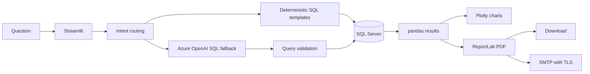

# Workforce Compass | AI Workforce Analyst

[](https://github.com/shree1216/AI-Analyst-chatbot_V2/actions/workflows/tests.yml)

Ask workforce questions in plain English. Explore department pay and headcount,
build PDF business reports, and email the results from one Streamlit application.

Built with **Python, SQL Server, Azure OpenAI, and Streamlit** using a synthetic
150-employee dataset. This is a local-first portfolio application, not a
production HR system.

[Getting Started](#local-setup-on-windows) | [Example Questions](#example-questions) |
[Architecture](#architecture) | [Tests](#tests) | [Deployment Notes](#deployment-note)


## Report Preview

Compare department averages, inspect the supporting numbers, and export a report
with findings, recommendations, and limitations.

**[View the sample department pay report (PDF)](docs/sample-department-pay-report.pdf)**

<details>
<summary>Department pay analysis</summary>


</details>

<details>
<summary>PDF download and email delivery</summary>


</details>

Screenshots and the sample PDF use the synthetic demonstration dataset. Salary
figures are displayed as INR; no pay period is inferred. Regenerating the sample
data may change the results.

## At a Glance

| Workflow | Result |
| --- | --- |
| Ask about the workforce | Database-backed answers and grouped metrics |
| Compare departments | Headcount and average-pay charts |
| Prepare a business report | Executive summary, tables, findings, and PDF download |
| Share a report | PDF attachment sent through authenticated SMTP with TLS |
| Ask by voice or upload an image | Optional Azure Speech and Azure OpenAI integrations |

## Architecture



Supported question patterns use deterministic queries; other employee questions
can use an Azure-generated SQL fallback. Query validation is an application
guardrail, not a replacement for database permissions or access controls.

## Features

- Ask natural-language questions about employees, departments, salaries, cities,
  employment status, and joining dates.
- Generate workforce breakdowns and interactive charts.
- Create business reports with findings and recommendations.
- Download reports as PDF files.
- Look up employee details such as department, city, email, and phone number.
- Optional Azure OpenAI support for generated SQL and response summaries.
- Optional Azure Speech support for voice input and spoken responses.
- Optional SMTP support for emailing PDF reports.
- General answers use the last six exchanges in the current chat, with long
    messages shortened. Previous-question recall uses actual session history.
    **New chat** clears that history; it is not persistent memory across sessions.
- Analyze uploaded JPG, PNG, and WebP images when Azure OpenAI is configured.

## Technology

- Python
- Streamlit
- pandas and Plotly
- SQLAlchemy and pyodbc
- Microsoft SQL Server Express
- Azure OpenAI and Azure AI Speech
- ReportLab

## Project Structure

| Path | Purpose |
| --- | --- |
| `employee_sql_chatbot.py` | Main Streamlit application |
| `employee_dataset.xlsx` | Synthetic 150-employee sample dataset |
| `generate_employee_dataset.py` | Recreates the sample Excel dataset |
| `import_employees_data.py` | Creates `EmployeeDB` and imports `dbo.Employees` |
| `.env.example` | Template for optional Azure and SMTP settings |
| `requirements.txt` | Python dependencies |
| `tests/test_employee_sql_chatbot.py` | Isolated routing, report, PDF, UI, and SMTP regression tests |
| `.github/workflows/tests.yml` | Windows / Python 3.14 CI workflow |
| `docs/` | Screenshots and a sample PDF report |

The application currently lives in one module. The other dataset generators and
loaders are earlier experiments; the setup below uses `generate_employee_dataset.py`
and `import_employees_data.py`. Separating the UI, query layer, and report services
is planned follow-up work, not a prerequisite for running the demo.

## Prerequisites

Install the following before starting:

1. Python 3.14 (verified locally with Python 3.14.6 on Windows)
2. Microsoft SQL Server Express with the `SQLEXPRESS` instance
3. Microsoft ODBC Driver 17 for SQL Server
4. Git

Direct dependencies are pinned to the locally tested versions. CI targets Python
3.14 on Windows; other Python versions and operating systems are not currently
verified. Transitive dependencies are resolved by pip, so this is not a complete
environment lockfile.

The application currently connects to:

```text
Server: localhost\SQLEXPRESS
Database: EmployeeDB
Table: dbo.Employees
```

Update the database settings near the top of `employee_sql_chatbot.py` and
`import_employees_data.py` if your SQL Server instance uses a different name.

## Local Setup on Windows

### 1. Clone the repository

```powershell
git clone https://github.com/shree1216/AI-Analyst-chatbot_V2.git
Set-Location AI-Analyst-chatbot_V2
```

### 2. Create and activate a virtual environment

```powershell
py -3.14 -m venv .venv
.\.venv\Scripts\Activate.ps1
```

If PowerShell blocks activation, run this once in the current terminal:

```powershell
Set-ExecutionPolicy -Scope Process -ExecutionPolicy Bypass
.\.venv\Scripts\Activate.ps1
```

### 3. Install dependencies

```powershell
python -m pip install --upgrade pip
python -m pip install -r requirements.txt
```

### 4. Create the SQL Server database and import the sample data

Make sure the `SQLEXPRESS` service is running, then execute:

```powershell
python import_employees_data.py
```

The script creates `EmployeeDB` when needed and replaces `dbo.Employees` with
the 150 rows from `employee_dataset.xlsx`.

> Run this importer only against a development database. It replaces the existing
> employee table; it is not a production migration or an incremental import.

Expected output:

```text
Imported 150 rows into [EmployeeDB].[dbo].[Employees]
```

### 5. Configure optional integrations

Copy the environment template only if you do not already have a local `.env`:

```powershell
if (-not (Test-Path .env)) { Copy-Item .env.example .env }
```

Add only the credentials for the integrations you want to use:

| Variable | Purpose |
| --- | --- |
| `AZURE_OPENAI_ENDPOINT` | Azure OpenAI resource endpoint |
| `AZURE_OPENAI_API_KEY` | Azure OpenAI API key |
| `AZURE_OPENAI_API_VERSION` | Azure OpenAI API version |
| `AZURE_OPENAI_DEPLOYMENT_MINI` | Chat model deployment name |
| `AZURE_SPEECH_KEY` | Azure AI Speech key |
| `AZURE_SPEECH_REGION` | Azure AI Speech region |
| `SMTP_HOST` | SMTP server hostname |
| `SMTP_PORT` | SMTP server port |
| `SMTP_USERNAME` | SMTP login username |
| `SMTP_APP_PASSWORD` | SMTP app password |
| `SMTP_FROM_EMAIL` | Sender email address |

Never commit `.env`, API keys, passwords, or
`.streamlit/secrets.toml`. These files are excluded by `.gitignore`.

For Gmail, use `smtp.gmail.com` on port `587`, your Gmail address for both the
username and sender, and a Google App Password with two-step verification enabled.
Do not use your normal account password. Generate a report, expand **Email PDF
report**, enter the intended recipient, and select **Send PDF report**. SMTP sends
outgoing mail only; this app does not read your inbox.

### 6. Run Workforce Compass

```powershell
python -m streamlit run employee_sql_chatbot.py
```

Open [http://localhost:8501](http://localhost:8501) in a browser.

## Example Questions

```text
How many employees are in each department?
Show the average salary by department.
Create a pie chart showing the proportion of Active, On Leave and Inactive employees.
Show a donut chart of employees by gender.
Show a bar graph of employee count by job title.
Show a column chart of average salary by department.
Show a line chart of monthly employee joinings.
Create a workforce report showing the breakdown by employment status.
Who are the top 3 highest-paid employees in each department?
What is the email address for Shree?
Create a PDF report comparing department salaries.
```

### Demo Walkthrough

1. Ask `Show a bar chart of employee count by department.`
2. Ask `Create a PDF report comparing the highest and lowest department pay.`
3. Inspect the summary and salary table, then select **Download PDF report**.
4. Optionally send the PDF using **Email PDF report** after configuring SMTP.

Department pay comparisons use the mean of the recorded employee salaries, not
total payroll or a job-adjusted pay-equity calculation.

Explicit pie, donut, horizontal bar, vertical column, and line chart requests
are supported in the chat and PDF reports. Without an explicit type, status and
gender proportions use pie charts, joining-date trends use lines, job-title
comparisons use horizontal bars, and other comparisons use columns.
For example, ask `Create a PDF report with a pie chart of employment status`.
Monthly and yearly trends group the current employee snapshot by joining date;
they do not reconstruct historical headcount or attrition. Missing-date records
are excluded from time-series query charts, and only recorded periods are plotted.

## Tests

From the repository root, with the virtual environment active:

```powershell
python -m pip check
python -m unittest discover -s tests -v
```

The regression suite uses small synthetic fixtures and mocks database access and
SMTP. It does not require SQL Server, Azure credentials, or a Gmail account, and
does not send real email. It covers query routing, department pay calculations,
headcount reconciliation, PDF generation, repeated report widgets, and email
validation, TLS sequencing, and attachments.

GitHub Actions runs these checks on pushes to `main` and on pull requests. The
workflow badge above links to the actual run status. Live service integration and
PDF visual layout still require manual checks.

## Recreating the Sample Dataset

The committed dataset is synthetic. To regenerate it:

```powershell
python generate_employee_dataset.py
python import_employees_data.py
```

Do not commit real employee names, email addresses, phone numbers, salaries, or
other confidential information.

## Deployment Note

The default `localhost\SQLEXPRESS` connection works only on the computer running
SQL Server. It will not connect from Streamlit Community Cloud or another hosted
environment.

Before deploying publicly, move the employee data to a secured hosted database,
configure database credentials through the hosting platform's secret manager,
and restrict access to sensitive workforce information.

## Security and Limitations

- Use synthetic data for public demos. The app has no application-level sign-in
    or role-based authorization and exposes workforce details to anyone with access.
- Use a dedicated read-only database identity for the app. SQL text validation
    alone is not a security boundary. Keep database creation/import privileges separate.
- Azure features can transmit questions, query results, or uploaded images to the
    configured service. Review data handling requirements before using real HR data.
- PDF reports can contain sensitive metrics. Verify recipient addresses before
    sending; SMTP acceptance does not guarantee inbox delivery.
- Recommendations are descriptive prompts for review, not evidence of causation,
    compensation fairness, or future attrition. The dataset lacks hiring targets and
    attrition events.
- Not every question or chart type is supported. Check generated results before
    using them for a business decision.

Do not include credentials or real employee records in issues, logs, screenshots,
or pull requests. If credentials are accidentally published, revoke and rotate
them; adding a file to `.gitignore` does not remove it from Git history.

## Troubleshooting

### ODBC driver error

Install Microsoft ODBC Driver 17 for SQL Server and verify that its name matches
the driver configured in the Python files.

### Cannot connect to SQL Server

- Confirm that the `SQL Server (SQLEXPRESS)` service is running.
- Confirm that the instance name is `localhost\SQLEXPRESS`.
- Run `python import_employees_data.py` before starting the chatbot.

### Streamlit command not found

Activate the virtual environment and use:

```powershell
python -m streamlit run employee_sql_chatbot.py
```

## Repository

<https://github.com/shree1216/AI-Analyst-chatbot_V2>

Created by **Vijayashree**.

## License

A reuse license has not been selected. Public visibility does not grant a general
license to reuse or redistribute this project's code; contact the repository owner
for permission. Third-party dependencies retain their respective licenses.
