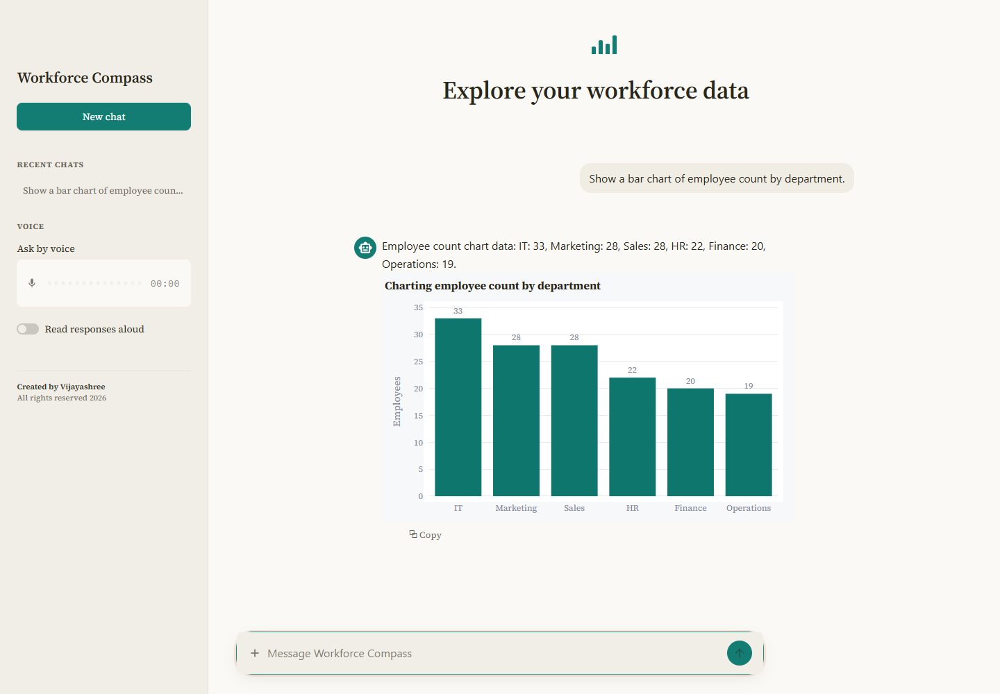
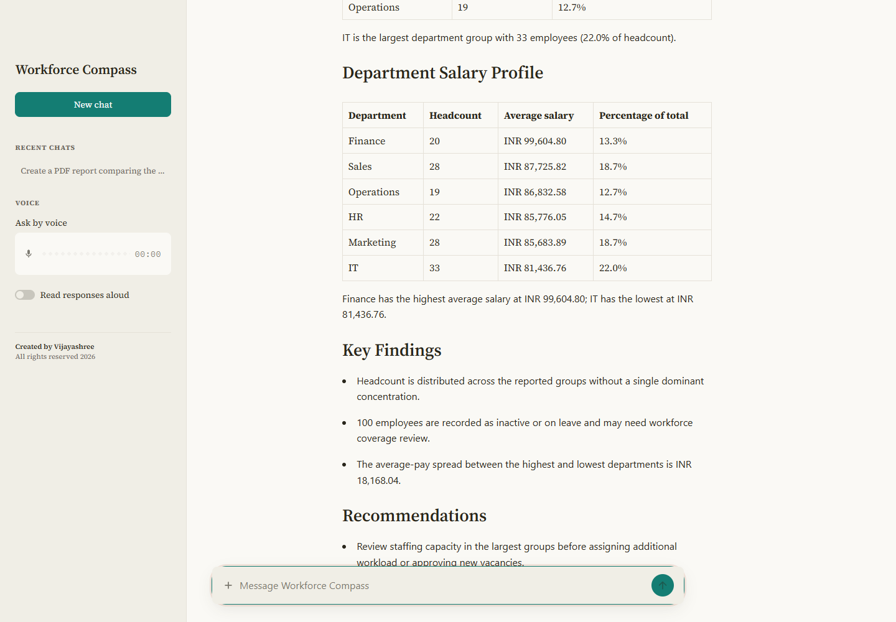
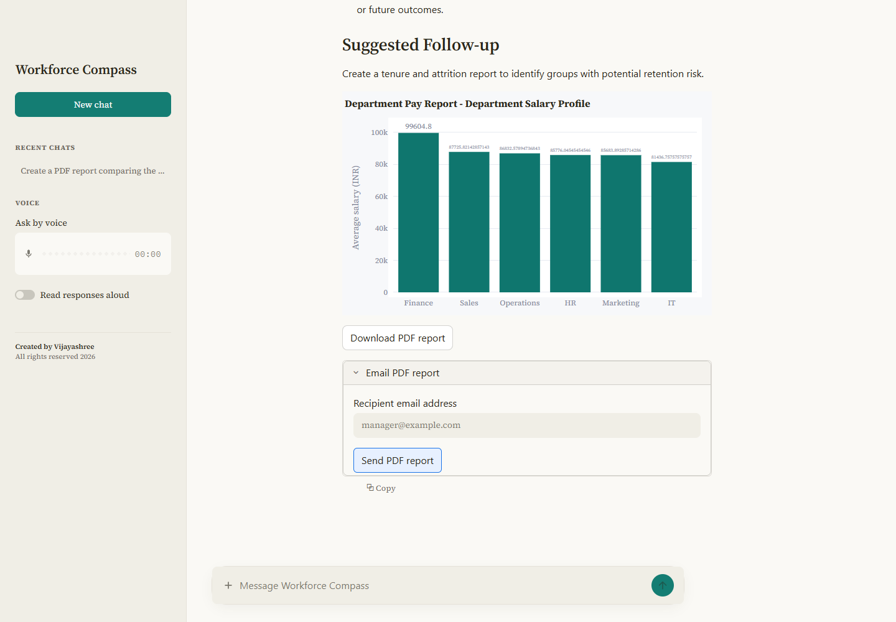
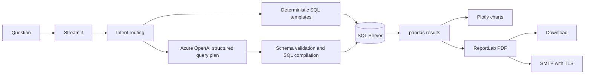

# Workforce Compass | AI Workforce Analyst

[](https://github.com/shree1216/AI-Analyst-chatbot_V2/actions/workflows/tests.yml)

**[Open the live Workforce Compass demo](https://workforce-compass-vijayashree.streamlit.app/)**

Ask workforce questions in plain English. Explore department pay and headcount,
build PDF business reports, and email the results from one Streamlit application.

Built with **Python, SQL Server, Azure OpenAI, and Streamlit** using a synthetic
150-employee dataset. This is a portfolio application, not a production HR system.
The local setup uses SQL Server; the optional cloud demo uses the bundled
synthetic dataset in a read-only, in-memory SQLite database.

[Getting Started](#local-setup-on-windows) | [Example Questions](#example-questions) |
[Architecture](#architecture) | [Tests](#tests) | [Deployment Notes](#deployment-note)



## Report Preview

Reports open with the generation date, applied scope, key metrics, executive
summary, and chart. **Detailed Breakdown** contains the supporting tables and
totals; **Data Notes** contains the source, limitations, and relevant analyst notes.

PDF exports use a portrait layout with summary and chart first, followed by
detailed tables with repeating headers, wrapped text, consistent INR formatting,
and numbered pages. Larger datasets can span additional pages; horizontal PDF
charts show up to 12 groups, while the detailed tables retain every group.
Long PDF chart labels are shortened to fit, with an explanatory note; complete
category names remain available in the detailed tables.

**[View the sample department pay report (PDF)](docs/sample-department-pay-report.pdf)**

<details>
<summary>Department pay analysis</summary>



</details>

<details>
<summary>PDF download and email delivery</summary>



</details>

Screenshots and the sample PDF use the synthetic demonstration dataset. Salary
figures are displayed as INR; no pay period is inferred. Regenerating the sample
data may change the results.

## At a Glance

| Workflow | Result |
| --- | --- |
| Ask about the workforce | Database-backed answers and grouped metrics |
| Compare departments | Headcount and average-pay charts |
| Prepare a business report | Key metrics, scope, summary, chart, detailed tables, and PDF download |
| Share a report | PDF attachment sent through authenticated SMTP with TLS |
| Ask by voice or upload an image | Optional Azure Speech and Azure OpenAI integrations |

## Architecture



Recognized simple counts, profile lookups, and chart/report patterns use existing
templates. Other employee questions use an Azure-generated JSON query plan, not
model-written SQL. The app validates columns, operators, types, ordering, and row
limits, then compiles SQL with bound filter values. Unresolved questions request
clarification instead of falling back to a total employee count. These checks
are not a replacement for database permissions or access controls.

## Features

- Automatically discover SQL tables and Excel worksheets, select only the sources
  needed for a question, and compare SQL actuals with Excel targets/budgets/lookups.
- Ask natural-language questions about employees, departments, salaries, cities,
  employment status, and joining dates.
- Generate workforce breakdowns and interactive charts.
- Create business reports with key metrics, applied scope, factual findings, and
    relevant analyst notes.
- Download reports as PDF files.
- Upload `.xlsx` workbooks with arbitrary columns and select a worksheet to query.
- Download query results and report summaries, breakdowns, and source data as Excel workbooks.
- Look up employee details such as department, city, email, and phone number.
- Azure OpenAI support for structured column queries; results are rendered directly
    from the database without displaying SQL or internal filter expressions in chat
    answers. Backend diagnostics separately include redacted SQL and calculation details.
- Optional Azure Speech support for voice input and spoken responses.
- Optional SMTP support for emailing PDF reports.
- General answers use the last six exchanges in the current chat, with long
    messages shortened. Previous-question recall uses actual session history.
    **New chat** clears that history; it is not persistent memory across sessions.
- Analyze uploaded JPG, PNG, and WebP images when Azure OpenAI is configured.

To analyze an image, attach it using the upload button in the message box and
select **Send message**. A question is optional. Successful submissions display
the image and analysis in the chat. Failed analyses keep the image with a specific
error and a **Retry image analysis** button; retrying does not require reuploading.
You can also resubmit the same image to ask a different question.
Image analysis allows 60 seconds and up to 2,000 completion tokens per request.
Images must be smaller than 4 MB; high-detail vision
is used for readability, but extracted text and numbers should still be checked.

### Automatic SQL + Excel questions

**Automatic (SQL + Excel)** is the default data-source mode. It requires Azure
OpenAI. The app reads the live table/column schema and SQL types for all visible
user tables in the configured database (not just the employee table), plus the
uploaded workbook's worksheet names, column names/types, and up to three sample
rows per worksheet. SQL row data is not fetched for source discovery. The Excel
preview/samples do not substitute for the full data used in calculations.

For each question the planner chooses the smallest necessary source set:

| Question | Sources used |
| --- | --- |
| `What is the total actual amount by department in SQL?` | Relevant SQL table(s) only |
| `What is the total budget in the Targets worksheet?` | Relevant Excel worksheet(s) only |
| `Compare SQL actual amounts against the Excel department budgets and show the variance.` | SQL actuals and Excel budgets, joined by the specified matching keys |
| `Use the Excel lookup to label the SQL results.` | Relevant SQL table and Excel lookup |

Only selected SQL queries execute, and only selected Excel worksheets are loaded
in full. SQL plans are validated against the discovered columns and compiled to
read-only, parameterized SELECT statements; model-written SQL/code is never
executed. SQL data can be filtered/grouped before matching to Excel. Combined
results use the existing bounded pandas join, lookup and calculation engine.
Targets must be matched at the correct grain (for example, department and month).
Ambiguous source names, keys, periods or missing sources request clarification
instead of inventing a join or silently substituting Excel targets for SQL actuals.
Each answer names the actual sources used and offers an Excel export.
Explicit SQL/database-only questions do not inspect uploaded Excel data;
explicit Excel/workbook-only questions do not inspect SQL. A plan that selects
different source kinds from those explicitly requested is rejected before any
data query runs. Without an explicit source, the planner selects the relevant
source(s) from the question and available schemas.
The planner's equivalent `count_rows`/`average` SQL aggregate names are normalized
to `count('*')`/`avg`, and an extra single `PLAN` wrapper around a calculation is
unwrapped before full validation. Unsupported operations, extra conditions and
unknown sources/columns are still rejected; no model-written SQL or Python runs.

The configured Azure planner receives SQL schema metadata and Excel sample rows
(at most three per sheet; sample strings are shortened to 160 characters), not
SQL result rows. Upload only workbooks that may be processed by your configured
Azure service. Sample cell values are excluded from backend logs.

Discovery supports at most 200 visible SQL tables and 20 Excel worksheets.
Each selected SQL result and Excel worksheet may contain up to 50,000 rows;
combined input is limited to 100,000 rows and 5 million cells. SQL reads request
one overflow-detection row and reject oversized results rather than silently
calculating totals from a 100-row preview. Explicit top/limit questions may use
a smaller limit. Chat previews still show at most 100 rows; exports retain the
full result. Database permissions remain the authority: use an account with
SELECT access only to the tables that should be available.

Source inspection/query failures are visible in diagnostics. A SQL outage does
not prevent an Excel-only answer, but it is explicitly reported and SQL-based
comparisons cannot be completed. Results and traces are cached with each answer;
rerunning the UI does not repeat queries. **New chat** clears those snapshots.
Failed automatic questions offer **Retry question**, using the workbook currently
uploaded (if any).

On startup, the app checks the deployed backend dependency revisions and refreshes
their imports together when they change. This prevents Streamlit hot updates from
mixing a new query planner with a cached older diagnostics schema, which previously
caused valid questions to fail with a backend-log field restriction message.
Unchanged reruns keep the same modules; schema privacy checks are not disabled.

The existing **Employee database** and **Excel workbook** modes remain available
for explicit single-source workflows, including supported questions without AI.
Workbook `open`/`close` commands retain Automatic mode when it is active.

### Excel workbooks

For the explicit Excel-only workflow, choose **Data source > Excel workbook** in the sidebar, upload an `.xlsx` file,
and select a **Worksheet**. A sheet named **Sales** is selected by default when
present; you can choose any other worksheet. The selected sheet is the default
source for new text and voice questions. Questions can explicitly name other
worksheets in the same uploaded workbook; they never replace or write to the employee database.
Each answer's source caption lists the worksheets actually used, including lookup/join sources.
Questions automatically choose worksheets using the available columns, not just
the preview selector. A broken preview does not block a question about another
valid sheet. Generic `count rows`/`preview` questions still use the selected sheet;
`count rows in products` targets the named sheet. Genuinely ambiguous matches
ask for a worksheet name instead of guessing.
Switch back to **Employee database** to resume workforce queries. Image
attachments continue to use the separate image-analysis workflow.

You can also control the workbook from the message box:

| Prompt | Behavior |
| --- | --- |
| `open Excel` | Shows the Excel upload controls; upload a file if none is loaded |
| `open Sales` | Selects the Sales worksheet in the uploaded workbook |
| `open Inventory` | Selects another worksheet by its exact name, ignoring case |
| `close Excel` | Unloads the active workbook and switches to employee database mode |
| `what's the last question?` | Recalls the last non-command question in this chat |

Worksheet commands accept both word orders: `open worksheet products`,
`open products worksheet`, and `open products sheet` all select **products**.
Quotes and case differences are accepted. A literal sheet name is matched first,
so a worksheet actually named **products worksheet** remains selectable without
being confused with **products**. Unknown names list the available worksheets
without changing the current selection.

These prompts work without Azure, including when the selected workbook has
invalid headers or no file is loaded. Opening a worksheet does not bypass workbook
validation. Switching data sources retains the active upload so `open Sales` can
restore it; explicitly closing Excel clears it and resets the uploader. Download
backups and updated workbooks before closing. Earlier answer snapshots remain in
the chat, and the original file on your computer is not modified. These commands
control the chatbot's workbook session, not the Microsoft Excel desktop app.

Recall also accepts `whats the last question?` and `what is the last question?`.
It includes questions that failed because a workbook could not load, skips
open/close commands and earlier recall requests, and works in both data-source
modes. **New chat** clears recall history; it cannot recover another session's
questions.

Use unique, nonempty text column headers in the first row. Workbooks must be
smaller than 10 MB (50 MB expanded), with at most 50,000 data rows and 100 columns
per selected sheet. Empty sheets, missing/duplicate headers, encrypted files,
and legacy `.xls` files are not supported. Formulas are not executed: only values
last saved by Excel are read, so recalculate and save the workbook first if needed.
Use Excel date cells or unambiguous ISO text such as `2025-01-31` for date operations.
Empty trailing header cells created only by formatting are ignored; populated
cells without headers are still rejected. Loading errors identify the worksheet
and affected cells (for example `A1` and `B1` for repeated headers). The same
specific error appears in chat, not a generic request to upload an already
uploaded file. Correct genuine header problems in Excel, save, and upload again;
the chatbot does not silently rename columns or modify your original workbook.

Ask `count rows`, `preview`, a simple total-sales question, or
`What are the total sales by region?` without Azure.
Unambiguous `Total Revenue by year and month of Order Date` questions also run
locally across the workbook. Header matching ignores spaces, underscores and case.
Unique Sales/Revenue and Date/Order Date transaction fields can be mapped, with
the actual columns shown in the answer caption. Joining dates are not substituted
for order dates. Multiple matching sheets or multiple candidate fields need
clarification; additional filters are not silently discarded.
For example, with numeric **Sales** (or **Revenue**, **Sales Amount**, or
**Total Sales**) and **Region** columns in the Sales sheet:

```text
What are the total sales for the North region?
```

The chatbot sums only North rows, ignoring blank sales cells, and responds in
plain language, such as **"The total sales for the North region is 1,500.75."**
That number is an illustration, not a value from your workbook. Region matching
ignores case and surrounding spaces. Missing numeric values are not reported as
zero, and no currency is inferred. Additional conditions outside this simple
grammar still use the validated AI planner; they are never silently ignored.

#### Create a Region_Summary worksheet

With a workbook containing a **Sales** worksheet uploaded, open **Create region
summary** in the sidebar:

1. Download **original backup**. The application retains an exact original-byte
   backup in the current session before creating an updated workbook.
2. Check **I confirm: add Region_Summary to a copy of this workbook**.
3. Select **Create Region_Summary**, then download the updated workbook.

The `write_region_summary(content, confirmed=True)` function in `excel_support.py`
returns `(backup_bytes, updated_workbook_bytes)`. Without explicit confirmation it
raises an error before opening or writing a workbook. It never writes to the
original uploaded file. The updated copy adds exactly **Region_Summary**, with
**Region** and **Total Sales** columns. If that name already exists (ignoring case),
the operation is refused rather than replacing or renaming any sheet.

The summary uses every row of the Sales worksheet, not the 100-row query preview.
It shares the existing sales-column selection and numeric validation rules.
Region names ignore surrounding spaces and case; blank regions are grouped
together with a blank label. Blank sales are ignored, but an entirely missing
regional total stays blank rather than becoming zero. Negative sales are retained.
Existing sheets, formula expressions, and supported formatting are retained using
openpyxl; advanced Excel features unsupported by that library may not round-trip,
so retain the original backup. Formulas are not evaluated. Both backup and updated
workbook are session-local downloads, not permanent server-side backups: save them
before closing the session.

Workbook helpers also accept a local `str` or `Path` instead of uploaded bytes.
They read the file without changing it; the summary function still returns backup
and updated-copy bytes, not an in-place disk edit. Missing or invalid paths explain
how to choose the file, and access/lock failures ask you to close Excel or other
apps and check permissions. A missing Sales worksheet explains how to add or
rename it and reupload. The chatbot shows these messages without technical error
details. An upload has already been copied into memory, so it does not need access
to the original local file after uploading.

Grouped sales totals use the same full-sheet aggregation as **Region_Summary**;
only the chat/table preview is capped at 100 regions; downloads include every result
region. Queries with additional
filters or ordering outside this local grammar still use the AI planner.

For more complex questions, configure the existing Azure OpenAI settings and name
your sheet's columns, for example:

```text
What is the total Revenue by Region?
Show Product and Stock where Stock is less than 10.
What is the average Revenue where Date is after 2025-01-01?
Show the top 3 Revenue records per Region.
What is the median Revenue by Region?
Count rows where Region is North and Revenue exceeds 500.
What percentage of total Revenue does each Region contribute?
Show Revenue divided by Cost, or zero when Cost is zero.
Look up each Product ID in Products and show its Product Name.
Join Sales to Products on Product ID and total Revenue by Category.
Pivot total Revenue with Region as rows and Product as columns.
Show the first 3 characters of Product Code and trim Product Name.
Total Revenue by year and month of Date.
How many completed months are between Order Date and Delivery Date?
```

Replace the example headers with those actually present in your workbook.
The planner receives worksheet names, column headers/types, unavailable-sheet
messages, and your question, **not worksheet rows or calculated results**.
It returns a validated declarative plan executed locally using pandas, never
AI-written SQL, Python, or `eval`. Existing selected-sheet helper callers retain
their validated in-memory SQLite query path; new workbook chat questions use
the workbook engine.

| Operation family | Natural-language calculation support |
| --- | --- |
| Math and aggregation | Sum, average, minimum, maximum, numeric/date count, nonempty count, row count, distinct count, median, arithmetic, percentages |
| Conditional aggregation | SUMIF(S), COUNTIF(S), AVERAGEIF(S)-style questions using one or several filters |
| Logic and filtering | IF with nested conditions, AND, OR, NOT, comparisons, blank checks, membership and literal text matching |
| Lookups and joins | Exact VLOOKUP/XLOOKUP/INDEX-MATCH-style lookups; first or last duplicate match; left, inner, right and outer joins, with up to five keys |
| Summaries | Grouping, pivots, numeric ranking with explicit tie rules, global or per-group top/bottom N |
| Text | LEFT, RIGHT, CONCAT, TRIM, case conversion, length; LEFT/RIGHT require a constant nonnegative character count |
| Dates | YEAR, MONTH, DAY, date construction/comparison, UTC today, completed day/month/year differences, monthly/yearly summaries |

These are **natural-language operations**, not a complete Excel formula interpreter.
Typed formulas, approximate/wildcard lookups, external-workbook links, arbitrary
macros/code, free-form data edits, and narrative/PDF reports for arbitrary sheets
are unsupported. Questions that cannot be fully interpreted request clarification
instead of silently ignoring conditions or switching to employee data.
Planner rejections include specific reasons and available column names, rather
than only a generic interpretation failure.

#### Backend log file

Open **Backend diagnostics** in the sidebar after asking an employee database or Excel question, then
select **Download backend log**. This downloads JSON-lines text as
`chatbot_backend.log` for this chat only. Each answer shows a request ID to match
against UTC timestamps, elapsed milliseconds, worksheet schemas/unavailable
sheets, automatic routing, planner status and structured plans, calculation step
details (columns, metrics, grouping, sorting, joins and filter structure), row/column counts,
export events and failures. Cached answers do not rerun or duplicate their traces.
For SQL Server and the hosted SQLite demo, the same log records the backend,
local planning, Azure planner requests/validation or plan-cache hits, read-query
start/completion/failure, readable SQL statements, parameter names/types (with values redacted),
query duration in milliseconds, SQL Server reconnect retry attempts, result column names/dimensions, and
Excel/PDF generation. Elapsed timestamps show where time is spent. Queries made
during employee-name resolution are included in the same request. The connection
test button also logs its latest check. Preparing an export is not proof that a
user downloaded it. General conversation is identified separately and does not
produce a database query event. Most Excel workbook calculations execute in pandas,
not SQL: their calculation steps show what was executed instead of inventing a SQL
query. The single-sheet SQLite query path also logs its SQL and source loading.

Query/source-selection events also include an `implementation` array containing
the Python source of the invoked query or calculation functions: function name,
source filename, first line number, language, and complete code (not shortened to
256 characters). This covers SQL execution, local Excel counts/previews/sales,
workbook expression/aggregation/join execution, and combined-source processing.
The log also includes the SQL plan compiler, Excel formula evaluator/aggregate
helpers, answer-formatting functions, and result-export implementation used by
SQL and Excel responses.
These are application implementation snapshots, not model-generated Python or
a line-by-line execution replay. Runtime arguments, locals and cell values are
not dumped. The validated plan and processing events identify the operations
used for that request. If source cannot be inspected, its entry explicitly
reports `status: "unavailable"`. Both the session download and rotating server log
contain the implementation entries; treat these files as private application code.
Existing cached answers keep their original logs; ask a new question to capture
implementation entries.

The app also writes a server-side `logs/backend.log`, with 2 MB rotation and
three backups (up to approximately 8 MB total). When running locally, this folder
is beside the application. On Streamlit Cloud it is on the hosting server, not
your computer; use the sidebar download there. Server logs contain metadata from
all users and must remain administrator-only; the app never exposes that shared
file as a download. SQL structure is included without the old 256-character
metadata truncation; SQL string/numeric literals and comments are redacted.
Bound parameter values and plan filter literals are redacted; names and types
remain visible. Question text, data-cell values,
credentials and raw exception details are excluded. Sheet/column names are
included, so still treat logs as private.

Downloads retain the latest 1,000 events, with at most 200 events per request.
**New chat** clears its downloadable traces, but does not delete the rotating
server log. Hosting storage may be ephemeral; save diagnostics before restarting
or closing the session. A server log-write failure produces a visible warning
without discarding the calculation or downloadable in-memory trace.

#### Choosing a source for automatic workbook refresh

Manual browser uploads are snapshots: editing the original file does not update
an already uploaded workbook. For a hosted app, keep the intended workbook in
OneDrive or SharePoint and configure authenticated server access before enabling
automatic refresh. Work/school Microsoft 365 and personal OneDrive use different
authentication setups; do not make a private workbook publicly accessible or put
access tokens/passwords in chat or source control. Store integration secrets in
the hosting platform's secret settings.

A laptop path, including a locally synced OneDrive path, is not accessible to
Streamlit Cloud. It only works for an app running on that computer or a separately
configured synchronization service. Automatic loading/refresh is not enabled by
the logging changes; selecting the storage/account type and configuring access
are still required. Manual upload remains available.

Calculations and downloaded results are read-only: calculated columns, pivots,
and joins do not add or edit uploaded sheets. Only the separate, explicitly
confirmed **Region_Summary** workflow creates an updated workbook copy.
Excel formula cells still use their saved cached values; the engine does not
recalculate existing workbook formulas.

Important calculation semantics:

- Numeric arithmetic/aggregations use floating-point precision; numeric text can
  be converted for calculations. COUNT counts numeric/date cells, not numeric text
  or booleans; conditional row counts use all matching rows. COUNTA counts non-null
  cells. Blank checks also recognize empty/whitespace text.
- No-match sums and counts are zero. All-missing sums and empty
  averages/minima/maxima/medians remain unknown. Missing comparison operands do
  not match; request a blank check to include them.
- IF evaluates arithmetic only for the chosen rows, so it can guard division by
  zero. Aggregate expressions inside IF still see the entire current table.
- Text comparisons and join keys ignore case and surrounding spaces; group labels
  retain their original text. Joins also match null keys. Duplicate join keys can
  multiply rows; exact lookups return only the first match unless the last is requested.
- TRIM collapses repeated ASCII spaces. Date text must be ISO-formatted, not
  ambiguous day/month text or numeric serials. Date differences require end >= start
  and count completed units. Timezone-aware dates are normalized to UTC.

Advanced questions support at most 20 worksheets, 100,000 total input rows, and
5 million total input cells, in addition to the per-sheet upload limits.
Invalid unrelated sheets are identified to the planner rather than blocking
valid-sheet calculations. Plans allow at most 20 steps, with bounded expression
complexity. Each intermediate result is limited to 50,000 rows, 200 columns,
and 5 million cells; joins and pivots check expansion before materialization.
Concatenations are limited to 32,767 characters per cell and 10 million total
output characters per operation. Oversized calculations return an actionable message,
not truncated inputs or partial answers.

Only the chat answer and supporting-data preview are capped at 100 rows.
**Download Excel includes all matching result rows**, up to the existing
50,000-row result safety limit, including rows beyond the preview. If the question
requests top/bottom N or a specific row limit, that requested limit still applies.
The caption shows preview and total result counts; calculations use every
matching source row. Downloads use streaming workbook generation to avoid keeping
a second full workbook cell grid in memory. Previously cached answers retain
their original snapshots; ask the question again to generate a complete new download.

Worksheet answers use plain-language sentences or labeled result lists, rather
than raw CSV or SQL. **Supporting data** contains the first 100 result rows, and
each successful answer offers **Download Excel**. Workforce report downloads
include a summary sheet, detailed breakdown sheets, and the report's source data;
the existing PDF download and email controls remain available. Numeric/date
cells keep their types and text beginning with `=` remains literal text, not an
executable formula. Workbook-question downloads contain the full calculated result
snapshot, not just the displayed preview or a copy of every source worksheet.
Employee database query limits are unchanged. Uploaded data and answer snapshots are local to
the current Streamlit session, not imported into SQL Server or shared via a global
cache. **New chat** clears answers but leaves the current data-source selection
in place. Prior spreadsheet result cells are excluded from general AI chat context.

#### Verify which data source is active

- **Employee database** shows **Active backend: SQL Server** or **SQLite demo
  (not SQL Server)**, plus the actual configured employee source. Select **Test
  employee data connection** to run a read-only row count. A successful check
  displays the count and check time; failures are shown explicitly.
- **Excel workbook** shows the uploaded filename, selected worksheet, row/column
  counts, and preview. Ask `count rows`, then compare a known region's total
  against the worksheet. This does not import the workbook into SQL Server.
- In employee mode, sales/revenue questions ask you to upload the Sales workbook
  rather than sending the calculation to general AI chat.
- General AI chat has a 2,000-token completion budget. If that budget is exhausted,
  the app explicitly reports the incomplete response; it does not present a
  partial answer as a completed calculation.

For local SQL Server verification, run this read-only query in SSMS against
`EmployeeDB` and compare its count with the connection check and chatbot:

```sql
SELECT @@SERVERNAME AS server_name, DB_NAME() AS database_name,
       (SELECT COUNT_BIG(*) FROM dbo.Employees) AS employee_count;
```

The hosted demo intentionally uses SQLite, not a connection to your laptop's
SQL Server. Cloud and local databases can therefore contain different data.
After local changes, commit and push all application files (including
`excel_support.py`) to the deployed branch. The hosted app must redeploy before
the new **Data source** controls appear; local tests alone do not update it.

## Technology

- Python
- Streamlit
- pandas and Plotly
- SQLAlchemy and pyodbc
- Microsoft SQL Server Express
- Azure OpenAI and Azure AI Speech
- ReportLab

## Project Structure

| Path | Purpose |
| --- | --- |
| `employee_sql_chatbot.py` | Main Streamlit application |
| `excel_support.py` | Bounded Excel parsing, worksheet schema inference, and literal-safe workbook exports |
| `workbook_operations.py` | Bounded, read-only workbook calculations, expressions, lookups, joins, rankings, and pivots |
| `backend_diagnostics.py` | Privacy-safe request traces, rotating server log files, and session log downloads |
| `source_queries.py` | Live SQL/Excel source discovery, source-plan validation, and bounded cross-source execution |
| `employee_dataset.xlsx` | Synthetic 150-employee sample dataset |
| `generate_employee_dataset.py` | Recreates the sample Excel dataset |
| `import_employees_data.py` | Creates `EmployeeDB` and imports `dbo.Employees` |
| `.env.example` | Template for optional Azure and SMTP settings |
| `requirements.txt` | Python dependencies |
| `tests/test_employee_sql_chatbot.py` | Isolated routing, report, PDF, UI, and SMTP regression tests |
| `packages.txt` | Linux native libraries for Streamlit Community Cloud |
| `tests/test_demo_database.py` | Real SQLite demo queries and cloud-mode UI regression tests |
| `tests/test_excel_support.py` | Workbook validation, arbitrary-column queries, Excel exports, and source-selection regression tests |
| `tests/test_workbook_operations.py` | Calculation semantics, cross-sheet operations, invalid plans, and expansion limits |
| `tests/test_backend_diagnostics.py` | Log rotation, isolation, metadata restrictions, failure handling, and step traces |
| `tests/test_source_queries.py` | Source discovery, SQL-only/Excel-only/combined execution, limits, parameterization, ambiguity, outages, and automatic-mode UI |
| `.github/workflows/tests.yml` | Windows and Linux / Python 3.14 CI workflow |
| `docs/` | Screenshots and a sample PDF report |

The application currently lives in one module. The other dataset generators and
loaders are earlier experiments; the setup below uses `generate_employee_dataset.py`
and `import_employees_data.py`. Separating the UI, query layer, and report services
is planned follow-up work, not a prerequisite for running the demo.

## Prerequisites

Install the following before starting:

1. Python 3.14 (verified locally with Python 3.14.6 on Windows)
2. Microsoft SQL Server Express with the `SQLEXPRESS` instance
3. Microsoft ODBC Driver 17 for SQL Server
4. Git

Direct dependencies are pinned to the locally tested versions. CI targets Python
3.14 on Windows and Linux (including the SQLite demo); the SQL Server setup is
Windows-only. The hosted demo has been checked for public access, employee counts,
department charts, and PDF downloads.
Transitive dependencies are resolved by pip, so this is not a complete
environment lockfile.

The application currently connects to:

```text
Server: localhost\SQLEXPRESS
Database: EmployeeDB
Table: dbo.Employees
```

Update the database settings near the top of `employee_sql_chatbot.py` and
`import_employees_data.py` if your SQL Server instance uses a different name.

## Local Setup on Windows

### 1. Clone the repository

```powershell
git clone https://github.com/shree1216/AI-Analyst-chatbot_V2.git
Set-Location AI-Analyst-chatbot_V2
```

### 2. Create and activate a virtual environment

```powershell
py -3.14 -m venv .venv
.\.venv\Scripts\Activate.ps1
```

If PowerShell blocks activation, run this once in the current terminal:

```powershell
Set-ExecutionPolicy -Scope Process -ExecutionPolicy Bypass
.\.venv\Scripts\Activate.ps1
```

### 3. Install dependencies

```powershell
python -m pip install --upgrade pip
python -m pip install -r requirements.txt
```

### 4. Create the SQL Server database and import the sample data

Make sure the `SQLEXPRESS` service is running, then execute:

```powershell
python import_employees_data.py
```

The script creates `EmployeeDB` when needed and replaces `dbo.Employees` with
the 150 rows from `employee_dataset.xlsx`.

> Run this importer only against a development database. It replaces the existing
> employee table; it is not a production migration or an incremental import.

Expected output:

```text
Imported 150 rows into [EmployeeDB].[dbo].[Employees]
```

### 5. Configure optional integrations

Copy the environment template only if you do not already have a local `.env`:

```powershell
if (-not (Test-Path .env)) { Copy-Item .env.example .env }
```

Add only the credentials for the integrations you want to use:

| Variable | Purpose |
| --- | --- |
| `AZURE_OPENAI_ENDPOINT` | Azure OpenAI resource endpoint |
| `AZURE_OPENAI_API_KEY` | Azure OpenAI API key |
| `AZURE_OPENAI_API_VERSION` | Azure OpenAI API version |
| `AZURE_OPENAI_DEPLOYMENT_MINI` | Chat model deployment name |
| `AZURE_OPENAI_DEPLOYMENT_VISION` | Optional image-capable deployment; defaults to the chat deployment |
| `AZURE_SPEECH_KEY` | Azure AI Speech key |
| `AZURE_SPEECH_REGION` | Azure AI Speech region |
| `SMTP_HOST` | SMTP server hostname |
| `SMTP_PORT` | SMTP server port |
| `SMTP_USERNAME` | SMTP login username |
| `SMTP_APP_PASSWORD` | SMTP app password |
| `SMTP_FROM_EMAIL` | Sender email address |

Never commit `.env`, API keys, passwords, or
`.streamlit/secrets.toml`. These files are excluded by `.gitignore`.

For Gmail, use `smtp.gmail.com` on port `587`, your Gmail address for both the
username and sender, and a Google App Password with two-step verification enabled.
Do not use your normal account password. Generate a report, expand **Email PDF
report**, enter the intended recipient, and select **Send PDF report**. SMTP sends
outgoing mail only; this app does not read your inbox.

### 6. Run Workforce Compass

```powershell
python -m streamlit run employee_sql_chatbot.py
```

Open [http://localhost:8501](http://localhost:8501) in a browser.

## Example Questions

```text
How many employees are in each department?
Show the average salary by department.
Give details of EMP015.
Show Name, Salary and Job Title for employee_id EMP015.
Show joining_date for employee_id EMP015.
How many Site engineers do we have?
Count female employees aged over 35 with salary above 70000.
How many female employees have a salary above 80000?
How many employees joined during 2023?
Count female employees aged over 35 and salary above 70000.
List employee ID, name and joining date for employees who joined in 2023.
Show employees whose phone number is missing.
Give the minimum and maximum salary by job title.
Create a pie chart showing the proportion of Active, On Leave and Inactive employees.
Show a donut chart of employees by gender.
Show a bar graph of employee count by job title.
Show a column chart of average salary by department.
I want the analysis on salaries.
Analyze highest and lowest department salaries.
Show a histogram of salaries.
Show a line chart of monthly employee joinings.
Create a workforce report showing the breakdown by employment status.
Who are the top 3 highest-paid employees in each department?
What is the email address for Shree?
Create a PDF report comparing department salaries.
```

### Column Queries

The query planner covers all columns in `dbo.Employees`: employee ID, name, age,
gender, department, city, status, job title, salary, joining date, email, and phone
number. The app still uses this plural table, not the separate `dbo.employee` table.

Use database column names or their underscored aliases: `Employee ID`, `employee_id`,
and `emp_id` refer to the same column; `Joining Date`, `joining_date`, and `join_date`
are also equivalent. Direct profile lookups distinguish IDs such as `EMP015` from
names and preserve leading zeroes. Profile requests with additional column
conditions use the query planner instead of treating the condition as a name.

Supported operations include counts, distinct counts, selected records, numeric
and date comparisons, text prefixes/suffixes/contains, missing values, AND/OR
filters, grouped count/average/sum/minimum/maximum, sorting, and top-N per group.
Row lists and grouped outputs are capped at 100 rows. General column questions
require a working Azure deployment; recognized simple queries still work without it.
Counts combining gender with age/salary comparisons, or joining these comparisons
with `and`, are handled locally without Azure. For example, `How many female
employees have a salary above 80000?` applies both filters with a strict `>` salary
threshold. Unsupported extra conditions are never silently dropped; more complex
questions, including OR conditions, still use the AI planner.
Joining-year counts such as `How many employees joined during 2023?` also run
directly without an AI request. The date filter includes January 1 of the requested
year and excludes January 1 of the next year; it can be combined with supported
gender, age, and salary conditions using `and`. This removes AI round-trip time
for these questions without caching stale database results or shortening timeouts.
Salary averages, totals, minima, and maxima also use the local query compiler,
including supported department/city/status filters and grouping by department,
city, gender, status, or job title. Common metric/field spellings such as
`avrage salry of sales`, `avg salary of Sales`, and `mean pay for Sales` are
accepted only within this salary-summary grammar; employee names and filter
values are not spell-corrected. Unrecognized scopes request clarification rather
than falling back to the whole workforce, and extra conditions still reach the
AI planner without being dropped. Missing salary values are not treated as zero.
New text questions appear before AI interpretation starts. Previous messages retain
their database-result snapshots and report PDFs, so reruns do not execute their SQL
or regenerate their PDFs. Submit a question again for fresh database values.
Up to 64 successful query interpretations are reused within the current chat;
this skips repeated AI calls without caching new submissions' database results.
New chat clears these interpretations. First-time AI questions still depend on
Azure response time, and failed queries are not cached.
Column-query answers show only results (or a no-match message), not query code or
internal filter expressions; copy and spoken responses use the same result text.
Ambiguous requests, unsupported calculations,
unavailable columns, and service failures cannot be guaranteed an answer. The app
distinguishes missing AI configuration, access errors, quota limits, timeouts, and
invalid service responses from requests that need clarification. Voice settings
do not configure the separate Azure OpenAI query service. Failed interpretations
never execute SQL, return a made-up count, or enter the successful-plan cache.
General chat also distinguishes access/connection/quota failures, empty responses,
declined requests, and response-length limits instead of hiding them behind one
generic retry message. Diagnostic logs record error categories, not credentials
or service response bodies.
Chart/report templates retain
their existing supported dimensions and metrics.

### Demo Walkthrough

1. Ask `Show a bar chart of employee count by department.`
2. Ask `Create a PDF report comparing the highest and lowest department pay.`
3. Inspect the summary and salary table, then select **Download PDF report**.
4. Optionally send the PDF using **Email PDF report** after configuring SMTP.

Department pay comparisons use the mean of the recorded employee salaries, not
total payroll or a job-adjusted pay-equity calculation.

Explicit pie, donut, horizontal bar, vertical column, line, and salary histogram
requests are supported in the chat and PDF reports. Automatic selection uses the
question's metric and grouping, not random chart rotation:

- Broad salary analysis and salary distributions use histograms of recorded salaries.
- Average-pay comparisons and rankings use horizontal bars, grouped by the requested field.
- Status and gender proportions use pie charts.
- Joining-date trends use lines.
- Job-title comparisons use horizontal bars; other categorical breakdowns use columns.

Explicit chart types override these defaults. Salary histograms use up to ten
equal-width bands; missing salaries are excluded, and constant salaries form one
band. Reports include mean and median salary and identify missing salary records.
Salary values are shown in INR as recorded, without assuming a pay period.

For example, ask `Create a PDF report with a pie chart of employment status`.
Monthly and yearly trends group the current employee snapshot by joining date;
they do not reconstruct historical headcount or attrition. Missing-date records
are excluded from time-series query charts, and only recorded periods are plotted.

## Tests

From the repository root, with the virtual environment active:

```powershell
python -m pip check
python -m unittest discover -s tests -v
```

The regression suite uses small synthetic fixtures and mocks database access and
SMTP. It does not require SQL Server, Azure credentials, or a Gmail account, and
does not send real email. It covers query routing, department pay calculations,
headcount reconciliation, PDF generation, repeated report widgets, and email
validation, TLS sequencing, and attachments.

GitHub Actions runs these checks on pushes to `main` and on pull requests. The
workflow badge above links to the actual run status. Live service integration and
PDF visual layout still require manual checks.

## Recreating the Sample Dataset

The committed dataset is synthetic. To regenerate it:

```powershell
python generate_employee_dataset.py
python import_employees_data.py
```

Do not commit real employee names, email addresses, phone numbers, salaries, or
other confidential information.

## Deployment Note

### Free hosted portfolio demo (no laptop or SQL Server required)

1. Push the project changes to your GitHub repository.
2. Sign in at <https://share.streamlit.io>, connect your GitHub account, and choose
   **Create app**.
3. Select repository `shree1216/AI-Analyst-chatbot_V2`, branch `main`, and main file
   `employee_sql_chatbot.py`.
4. Choose an available app subdomain. This project's deployed demo uses
   <https://workforce-compass-vijayashree.streamlit.app/>; a fork needs its own
   available name.
5. In **Advanced settings**, select **Python 3.14** and add this root-level secret:

   ```toml
   WORKFORCE_DATA_MODE = "demo"
   ```

6. Click **Deploy**. Verify that the app answers `How many employees do we have?`,
   renders `Show a bar chart of employee count by department`, and downloads a PDF.
   Share the URL shown by Streamlit after these checks succeed.

Demo mode loads `employee_dataset.xlsx` into SQLite once per application process,
uses the same query validation and bound parameters as the local app, and rejects
database writes. No SQL Server, ODBC driver configuration, or cloud database
account is required. The original SQL Server mode remains the default when
`WORKFORCE_DATA_MODE` is not set. Invalid mode values fail explicitly.

Counts, lookups, supported charts, and PDF reports work without Azure credentials.
Open-ended chat, AI-planned queries, image analysis, and voice still need their
respective Azure settings. Root-level Streamlit secrets become environment
variables; use the names in `.env.example`. Environment variables take precedence
over the local `.env` file. Never commit `.env` or `.streamlit/secrets.toml`.
For an anonymous public demo, leave SMTP credentials unset and avoid adding Azure
credentials unless you accept visitor usage charges and have suitable controls.
There is no authentication or per-user rate limit in this app.

#### Enable all hosted integrations

Local credentials are not uploaded during deployment. In the live app, open
**Manage app > Settings > Secrets** and enter the following root-level settings
with your own values, retaining `WORKFORCE_DATA_MODE = "demo"`:

| Feature | Required settings |
| --- | --- |
| Voice input and spoken responses | `AZURE_SPEECH_KEY`, `AZURE_SPEECH_REGION` |
| AI chat and flexible workforce queries | `AZURE_OPENAI_ENDPOINT`, `AZURE_OPENAI_API_KEY`, `AZURE_OPENAI_API_VERSION`, `AZURE_OPENAI_DEPLOYMENT_MINI` |
| Image analysis | The OpenAI settings above with a vision-capable deployment, or an additional `AZURE_OPENAI_DEPLOYMENT_VISION` |
| Email PDF reports | `SMTP_HOST`, `SMTP_PORT`, `SMTP_USERNAME`, `SMTP_APP_PASSWORD`, `SMTP_FROM_EMAIL` |

Secrets use TOML syntax, for example `AZURE_SPEECH_REGION = "eastus"` (use the
actual region of your resource). Save, allow the app to restart, then reload.
Never paste credentials into the chatbot, issue reports, or source code.
Microphone access must also be allowed in the visitor's browser.
Keep the recorder disabled until Speech settings are present; showing an enabled
recorder alone does not verify that the Speech service works.

Verify each integration after configuration: record a short question, enable
**Read responses aloud**, ask a general question, analyze a harmless sample image,
and send a PDF to an inbox you control. Confirm actual email receipt.
Public access allows visitors to consume Azure quotas and send reports through
the configured sender account; only enable these services if that is intended.
The sidebar omits deployment labels and credential-setup instructions; dataset
provenance remains in report data notes and this documentation.

To test demo mode locally:

```powershell
$env:WORKFORCE_DATA_MODE = "demo"
python -m streamlit run employee_sql_chatbot.py
```

Use `Remove-Item Env:\WORKFORCE_DATA_MODE` afterward to restore the default for
future launches in that terminal (unless the mode is also set in `.env`).
Free hosting may put inactive apps to sleep; the hosted URL remains shareable,
but this is not a promise of continuous uptime.

### SQL Server deployment

The default `localhost\SQLEXPRESS` connection works only on the computer running
SQL Server. It will not connect from Streamlit Community Cloud or another hosted
environment. Hosting the SQL Server version requires a secured hosted database
and changes to its connection configuration; use the platform's secret manager
and restrict access to sensitive workforce information.

### Cloudflare Error 1033

Error 1033 means Cloudflare cannot find a healthy tunnel connection. A
`trycloudflare.com` quick-tunnel link is temporary, not a hosted deployment:
the computer, Streamlit process, and tunnel must all remain online. Restarting a
quick tunnel usually gives a different URL, so an old link will not be restored.
Use the hosted demo above for a stable sharing address independent of your laptop.

## Security and Limitations

- Use synthetic data for public demos. The app has no application-level sign-in
    or role-based authorization and exposes workforce details to anyone with access.
- Use a dedicated read-only database identity for the app. SQL text validation
    alone is not a security boundary. Keep database creation/import privileges separate.
- Azure features can transmit questions, query results, or uploaded images to the
    configured service. Review data handling requirements before using real HR data.
- PDF reports can contain sensitive metrics. Verify recipient addresses before
    sending; SMTP acceptance does not guarantee inbox delivery.
- Recommendations are descriptive prompts for review, not evidence of causation,
    compensation fairness, or future attrition. The dataset lacks hiring targets and
    attrition events.
- Not every question or chart type is supported. Check generated results before
    using them for a business decision.

Do not include credentials or real employee records in issues, logs, screenshots,
or pull requests. If credentials are accidentally published, revoke and rotate
them; adding a file to `.gitignore` does not remove it from Git history.

## Troubleshooting

### ODBC driver error

Install Microsoft ODBC Driver 17 for SQL Server and verify that its name matches
the driver configured in the Python files.

### Cannot connect to SQL Server

- Confirm that the `SQL Server (SQLEXPRESS)` service is running.
- Confirm that the instance name is `localhost\SQLEXPRESS`.
- Run `python import_employees_data.py` before starting the chatbot.

### Streamlit command not found

Activate the virtual environment and use:

```powershell
python -m streamlit run employee_sql_chatbot.py
```

## Repository

<https://github.com/shree1216/AI-Analyst-chatbot_V2>

Created by **Vijayashree**.

## License

A reuse license has not been selected. Public visibility does not grant a general
license to reuse or redistribute this project's code; contact the repository owner
for permission. Third-party dependencies retain their respective licenses.
